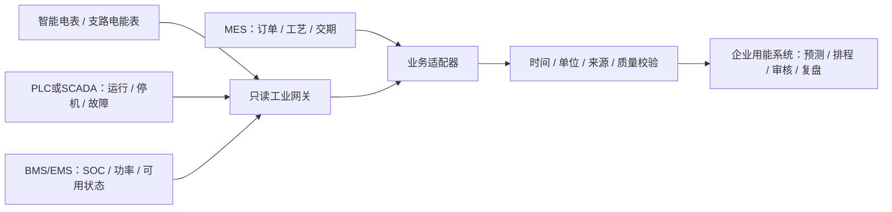

# 生产线现场设备接入设计

本文件区分“已实现的只读观测接口”和“尚待现场适配的工业协议”。当前程序没有直接连接真实电表、PLC、BMS、MES或SCADA；默认生产示例和Demo设备是合成数据。页面内“设备编号”用于约束资源互斥，设备监测页则显示明确来源、质量码、到达时间和Demo/REAL模式。

## 1. 企业落地链路



建议先接计量与状态，再接生产计划。现场保护和设备联锁仍由原有控制系统负责。当前软件输出人工审核的候选方案；若后续设计受控执行，需要单独的指令网关、授权、回执、超时及回退方案。

## 2. 可以结合的设备和系统

| 对象 | 可读字段 | 对企业的作用 | 与当前软件衔接 |
| --- | --- | --- | --- |
| 车间/总进线智能电表 | 时间、累计电量、平均功率、质量码 | 看清哪条线、哪个班次用电，核对执行曲线 | 先导出标准CSV；后续只读适配 |
| 设备支路表与状态采集 | 功率、运行/待机、故障、设备ID | 校准工序功率、发现任务是否按时运行 | 设备编号匹配工序；后续补状态表 |
| PLC、SCADA | 开停、报警、联锁状态、维护许可 | 避免给停机检修设备安排生产 | 当前用禁运行小时；实时联动待做 |
| MES、ERP | 订单、数量、工艺路线、交期、班次 | 用真实生产要求替代手填演示任务 | 当前手工录入任务，后续订单接口 |
| 储能BMS、PCS、EMS | SOC、功率、温度、告警、可用容量 | 按真实可用状态评估储能计划 | 当前手工确认参数，实时遥测待接 |
| 边缘网关/工控机 | 协议转换、时间戳、缓存、重传 | 汇总多设备并记录断线缺数 | 后续适配器承担，不由AI处理底层协议 |

单片机可用于比赛台架采集低压电流、模拟设备状态、显示方案和模拟SOC；企业正式计量和设备控制需使用企业确认的仪表、网关与控制接口。台架信号和企业正式计量应分别标识，避免混入核验数据。

## 3. 接口约定

由企业提供真实设备手册、点表、量程、倍率、时区、时间粒度、网络与只读权限后确定协议。可依据设备能力设计 Modbus RTU/TCP、OPC UA、MQTT 或 HTTP 适配器，不能只凭设备名称假设已支持某协议。

建议入库字段：企业、站点、计量点、设备ID、采集时间、到达时间、指标、原值、单位、倍率、质量码、序列号、来源系统、原报文摘要。数据到达后校验单位、时区、重复、断线、迟到及仪表复位。累计电量先处理复位与倍率，再计算区间差值；不得把缺测直接记成零。

当前已经提供设备台账、只读遥测保存和边缘网关HTTP接口：`POST /api/gateway/telemetry`使用按设备生成的Bearer凭据，只能向绑定设备上报，凭据哈希保存、90天过期且只显示一次；`GET /api/devices`和`GET /api/telemetry?deviceId=...`只允许工作空间成员读取。批次按规范化JSON去重，同一设备同一时刻的冲突数据整批拒绝；时间、质量码、单位范围、状态、额定功率、SOC和温度越限会形成可追溯问题。遥测表与企业计费数据分开，Demo设备不进入账单、预测证据或正式方案指纹。

网关请求示例：

```json
{
  "deviceId": "METER-01",
  "source": "edge-gateway-01",
  "points": [
    {"timestamp": "2026-10-22T08:00:00+08:00", "quality": "GOOD", "values": {"powerKw": 612.4, "energyKwh": 612.4}}
  ]
}
```

仓库`integrations/gateway_push.py`是没有协议依赖的最小上报客户端。现场网关可先把Modbus、OPC UA、MQTT或SCADA点表转换为上述格式，再通过HTTPS上报；本示例不会读取或控制PLC、PCS、BMS，也不会把token写入日志。接入前仍要让网关按现有标准列生成文件，验证曲线与仪表原报表一致。

## 4. 最小现场试点

1. 选择一条可调整连续工序的生产线，确认原计划与总进线/支路电表关系。
2. 导入至少一个完整账期的电价、负荷、合同和正式账单，核清费用；模型训练需更长且有代表性的分时历史。
3. 读取设备运行与检修信息，验证设备编号、时间窗口和任务功率；与生产负责人确认产量、交期和安全限制。
4. 原计划与候选同时离线评估。人工批准后执行，收集实际分时计量和偏差。
5. 由财务确认费用范围与反事实基准，按账期验证结果，再决定是否扩展更多产线或接入执行接口。

应急供电、医院关键负荷等场景需要备用电源容量、切换时间、负荷分级与连续供电专业设计。当前日内成本优化模型没有验证这些可靠性条件；不能将其充放电建议直接作为应急保电方案。
