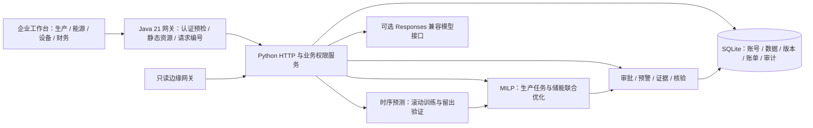
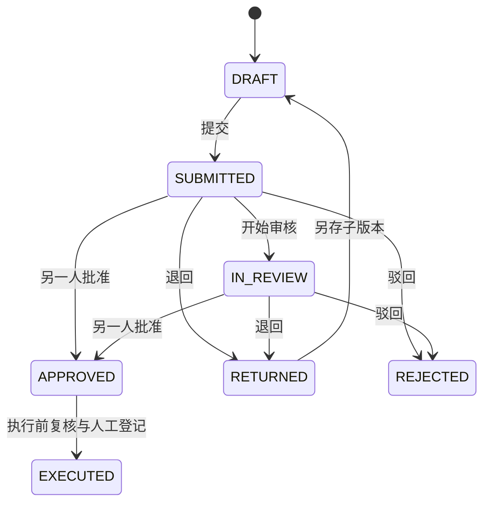

# 企业生产用能决策系统：设计与需求追踪

更新：2026-10-22。需求基准为用户提供的《电力现货市场用能成本优化项目需求分析 (2).docx》。本设计区分本次可运行能力、受限实现和需企业提供资料后完成的适配。保留原需求文件，不将原型演示当作真实企业验收。

## 1. 产品与业务目标

面向工业企业能源、生产、设备、财务与审核人员，统一价格、负荷、合同、生产条件、储能和账单依据，形成“导入与核对 → 预测 → 五方案比较 → 人员审核 → 执行登记 → 效果核验”的工作流。

主场景是生产流水线。例如同一订单的下料、热处理、加工与检测，允许调整开始时间，但任务量、工序时长与前后顺序保持。共用设备、班次窗口、维护时段及并网限制共同决定能否移峰。农业泵站、冷库等可复用该框架，但不影响工业生产线作为默认场景。

## 2. 实际架构

前端为原生 JavaScript，不依赖构建服务器。Java 使用 JDK HTTP Server 与虚拟线程，所有受保护 API 先通过 Python 会话端点检查 Bearer Token，再转发；Python 再检查工作空间及动作角色。Java 并未独立实现审批、财务或结算引擎。后续可保留接口，将业务应用层逐模块迁移至 Java 服务。

Python 含数据、预测、优化、治理四组模块。MILP 在专用单线程执行器运行，避免本机求解库在线程间反复初始化引起不稳定。SQLite 适合本地与单机试点；不宣称多节点高并发部署。

## 3. 页面与使用角色

| 页面 | 关键行为 | 主要角色 |
| --- | --- | --- |
| 企业看板 | 数据质量、预测、待审核、试点条件 | 全体成员 |
| 数据接入 | CSV/XLSX/JSON、来源、授权、粒度、拒绝批次 | 管理员、能源分析员 |
| 企业与约束 | 购电、计量点、规则引用、并网、储能 | 管理员、能源分析员 |
| 生产线排程 | 多工序任务表、设备、订单、前置关系、甘特图 | 管理员、能源分析员，生产人员参与确认 |
| 预测与风险 | 基线/模型、方法选择、独立测试误差 | 全体成员 |
| 成本优化 | S0—S4、逐小时动作、费用、缺口 | 管理员、能源分析员 |
| 审核与执行 | 草稿、提交、另一人审核、子版本、执行登记、压力评估 | 按动作角色限制 |
| 账单复核 | 项目数量与单价复算、差异、正式凭证确认 | 管理员、财务 |
| 预警与处置 | 级别、类型、状态、责任人筛选和处置 | 有权限的业务成员 |
| 月度规划 | 合同覆盖率、现货敞口、低/中/高价预算 | 管理员、能源分析员 |
| 结算规则版本 | 来源、有效期、范围、说明、另一人审核 | 管理员、财务、批准人 |
| AI解释 / 证据与报告 | 指定快照解释、字段来源、JSON与HTML导出 | 全体成员 |
| 企业成员 | 邀请、加入、切换、撤销访问 | 管理员管理；成员加入与切换 |
| 设备与产线 | 设备台账、质量码、状态、功率/SOC/温度、遥测历史、网关上报、产线关联和执行前检查 | 能源、设备、生产和审核成员按权限读取；管理员/分析员/设备负责人维护 |

角色为 OWNER、ANALYST、APPROVER、FINANCE、PRODUCTION、DEVICE、VIEWER。生产负责人可以维护生产约束，设备负责人可以维护设备台账和遥测；二者不能代替批准人审批或执行方案。注册获得自己的空间；邀请码加入其他企业后按服务器选定空间访问。撤销成员后，下一次访问回到其个人空间。部门、会签、审批金额阈值、SSO/MFA待扩展。

## 4. 生产线任务模型

| 字段 | 含义与校验 |
| --- | --- |
| id / name | 企业空间内唯一任务ID、工序名称 |
| line / equipmentId | 产线或车间分组、共用设备资源编号 |
| orderNo / quantity / quantityUnit | 订单号、本次固定任务量与单位；数量大于0 |
| powerKw / duration | 固定功率、整小时连续时长1—24 |
| baselineStart | 原计划开始小时；任务不能跨日 |
| windowStart / windowEnd | 最早开始与最晚完成；结束可填24 |
| forbiddenHours | 安全、班次、检修等禁止运行小时 |
| predecessors | 已存在任务ID数组；禁止自引用、未知ID及循环依赖 |

每道任务只选择一个候选开始小时。前置约束为 `开始(后序) >= 开始(前序) + 时长(前序)`。同一设备在任一小时最多被一个任务占用。各产线共享企业并网限额。

任务数量目前是冻结的要求，不参与产速、良率或物料平衡计算；系统以保持任务及连续时长防止通过取消工序制造节省。对每小时预测总负荷，扣去原计划工序形成基础负荷，再加候选工序与储能。若扣除后出现负值，拒绝计算并提示原计划不一致。

目前最多8个连续任务、一套储能、24个小时。跨日、多批次队列、缓冲仓、物料批次、变速、爬坡、启停成本、最小开停机时长和人员技能排班需建立扩展模型。设置相同产线名称不会自动禁止工序并行；只有相同设备编号或前置约束限制并行。

## 5. 数据与费用口径

价格元/MWh，负荷kW，小时电量kWh，金额元，北京时间。公开日级市场汇总与企业分时数据分开，日均价不会填充为24个小时价格。

CSV、XLSX第一工作表和JSON记录统一转成标准列。保留原文件、原格式、二进制或文本SHA256、标准化摘要、来源、计量点、授权说明和收到时间。XLSX拒绝公式，防止缓存结果与可见公式不一致。文本解析/文件结构错误直接返回400；已进入记录校验的错误批次隔离保留，不发布部分行。

15分钟聚合时，小时负荷为四段平均值，小时电量等于四段功率乘0.25小时的和；价格按各段负荷加权，使原始购电费用守恒。如果小时负荷为零，采用四段价格平均。合同电量求和；合同小时等效价满足：

`小时合同电量 × (等效合同价 − 小时参考价) = Σ[区间合同电量 × (区间合同价 − 区间参考价)]`

该等效价用于当前数据曲线的小时分析，不代表原合同成交价，也不能准确保留移峰后所有15分钟内部结算效应。对必须15分钟结算和执行的企业，应将优化器扩展为96时段，而不能将小时近似结果当作精确分钟结算。

费用计算在程序中完成：

`分时购电参考费 = Σ(购电kWh × 预测元/MWh ÷ 1000)`

`固定合同差额 = Σ[合同kWh × (合同价 − 预测价) ÷ 1000]`

`场景成本 = 购电参考费 + 固定合同差额 + 放电寿命成本 + 已安装储能日运维`

这是配置分析模型，不等同山西正式结算引擎。输配电、需量/基本费、税费和正式调整未进入优化目标，并在输出中标记。账单模块可逐项人工录入这些费用核对，但未将其全部自动映射到调度求解。规则版本记录来源与说明，不执行任意公式代码，也不自动切换复杂结算公式。

## 6. 五类方案与预测

| 类型 | 本次行为 | 缺少相关输入时 |
| --- | --- | --- |
| S0 | 原生产计划、已有合同、储能空闲、固定日运维 | 基准未核实则成本空值 |
| S1 | 相同原计划下固定合同差额分析，合同量未优化 | 缺合同为数据不足；口径不同为不适用 |
| S2 | 仅调整工序，储能空闲 | 无可调工序为不适用 |
| S3 | 原工序不动，仅优化储能 | 无储能为不适用；参数未确认为数据不足 |
| S4 | 联合选择工序与充放电 | 缺少必须参数或约束冲突时分别提示 |

五种成本在同一预测、原始负荷、合同和费用范围下独立计算，统一与 S0 比较。联合结果不是 S2、S3 差额的算术和。求解器超时、不具备数据、不可行分别返回状态，未知金额保持 null。

原计划储能空闲是明确的当前假设。如果企业已有储能运行计划，必须先扩展S0，按原有动作比较，不能夸大增量效果。S1没有执行中长期交易量的组合优化。

预测候选包括前日、近7日同小时均值、时序岭回归、多源岭回归。训练与缺失处理仅使用历史数据；气象/新能源为滞后观测，未伪装成未来已知值。至少14个完整日后分离方法选择期与后续独立测试期；测试期间可随时间滚动加入此前已知数据重新拟合，但不据测试误差重新选方法。分别报告价格、负荷和高价时段误差。误差带是历史经验误差，不是已校准的置信保证。

## 7. 版本、审批与压力评估

退回到草稿的箭头表示新建子版本，原记录保留原状态。保存时冻结参数、数据来源、模型、费用范围和输入指纹。父子版本保存原因与参数差异；变更前后输入可从两个完整快照比较。批准不修改旧快照。提交人与批准人必须不同；状态更新使用写事务与条件更新，重复并发审批只允许一次成功。

提交、批准、执行前检查输入版本和相关阻断预警。执行仅支持今日批准版本的人工记录，避免把历史模拟登记成当前执行。

压力模式 FIXED 保持工序和充放电动作，改变价格绝对值或基础负荷百分比；REOPTIMIZE 同条件重新求解，另存评估子稿。两种模式都重算扰动后的 S0 和候选，报告可行性、差额和越限时段。假设子稿不能直接进入正式提交/执行；采纳时应先确认并录入正式数据，再新建普通子版本审核。当前未扩展设备故障、订单变化、合同失效等专用压力场景。

## 8. 预警闭环

类别包含数据、价格、负荷、合同、账单、储能、版本、执行和可行性；级别为提示、一般、重要、阻断。每条记录保留日期、时段（适用时）、字段、值、阈值、单位、数据批次、参数/规则版本、方案、责任人、期限和处理记录。

系统对缺数据/过期、预测阈值、合同缺失/敞口、账单差异、版本失效、并网余量、当前计算SOC/功率/互斥及执行登记偏差检查。相同版本和条件去重，重复打开页面不重复生成无限记录。条件解除后自动解决并写审计；手动核验关闭也先重查条件。阻断预警禁止忽略或误报绕过。

现阶段检查由工作台/预警请求触发，不是全天候设备监控。主工作台已提供设备与产线页面，可登记设备台账、查看只读遥测、质量码、来源批次和现场边界；责任人仍是人工填写姓名/岗位，不是完整轮值排班。邮件/短信/Webhook、超时升级、实时BMS告警及全部文档触发规则尚未实现。

## 9. AI证据与效果核验

AI只能读取当前授权空间和所选快照。结构化证据含金额、并网限额、各任务开始时间、小时预测价格、单位、日期、批次、参数/模型版本、计算指纹和方案ID。解释指定历史方案时使用其冻结价格与生产任务；当前缺口检查属于当前状态，另行展示。问答、回答模式、证据与用户反馈留档。模型不能自行调用批准或设备控制动作。

模拟差额仅为同一预测场景的成本比较。实际节省核验必须具备执行记录、不同于执行登记人的财务/管理员、已确认正式账单、24小时实际曲线、经确认反事实基准与排除因素，并校验实际电量、SOC、功率和复算金额。保留负节省；同一方案不可重复覆盖核验。

当前支持单日、同费用范围核验；月账单跨日归因、产量/天气归一化及统计因果归因尚需真实企业建模。系统记录输入依据，无法仅凭文本验证凭证真实性。演示样本核验仍标明合成演示，不作为真实节省业绩。

## 10. 数据表与接口

| 数据组 | 主要表 |
| --- | --- |
| 身份与空间 | app_user、user_session、workspace_member、workspace_invite、workspace_selection |
| 数据与参数 | market_daily、import_batch、import_metadata、enterprise_interval、enterprise_profile |
| 版本与账单 | business_plan、bill_reconciliation、enterprise_event |
| 风险与效果 | alert_rule、alert_record、alert_action、stress_run、saving_verification |
| 规划与解释 | long_term_plan、settlement_rule、ai_exchange |
| 现场观测 | device_registry、device_ingest_batch、device_sample |

生产任务与设备约束目前作为 enterprise_profile 版本及 business_plan 快照的JSON保存，尚未拆为完整订单/设备主数据系统。business_plan 新列由初始化迁移添加。enterprise_event 使用触发器限制应用层更新和删除，不代表可抵御数据库管理员修改的外部存证。

| API组 | 端点 |
| --- | --- |
| 身份 | POST /api/auth/register、login、logout；GET /api/auth/me |
| 工作台 | GET /api/dashboard、workflow、market-summary |
| 数据 | GET /api/datasets、template、import-source；POST /api/import、demo |
| 参数与计算 | GET/POST /api/profile；GET /api/forecast、optimize |
| 版本 | GET/POST /api/plans；POST /api/plans/review、execute |
| 协作 | GET /api/team；POST /api/team/invite、join、switch、revoke |
| 预警 | GET /api/alerts；POST /api/alerts/action、refresh、rules |
| 评估与财务 | GET/POST /api/stress、long-term、rules；GET/POST /api/bills；POST /api/bills/confirm、savings/verify；GET /api/savings |
| AI与报告 | POST /api/ask、ai/feedback；GET /api/ai/history、evidence、report、events |
| 设备与遥测 | GET /api/devices、telemetry；POST /api/devices、devices/demo、devices/token、telemetry；网关 POST /api/gateway/telemetry |

所有业务端点使用 Bearer Token。客户端不传任意企业ID来选择数据；成员切换必须通过已授权的工作空间列表。404用于隐藏不存在或无权限对象，403为动作角色不足，409为版本、状态或前置条件冲突，400为输入不合法。

## 11. 需求对应与剩余适配

| 文档需求 | 当前交付 | 边界 / 后续 |
| --- | --- | --- |
| 统一数据、原始追溯、15分钟 | 文件导入、质量检查、聚合、SHA256与下载；设备批次按哈希和设备时刻去重 | 96时段直接优化、外部定时采集待做 |
| 历史账单逐项核对 | 十进制复算、每项及总差额、凭证确认 | 完整省级自动结算适配待做 |
| 次日电价与负荷、多源模型 | 基线/岭回归、多源滞后特征、独立测试 | 真实天气预报、节假日和季节数据待接 |
| S0—S4及空值规则 | 五场景独立、统一基准、缺口与不适用 | S1合同交易优化、已有储能基准待扩展 |
| 多产线与生产限制 | 8任务、订单、设备互斥、前置关系、窗口、甘特图 | 复杂产能、跨日、爬坡/启停待扩展 |
| 储能安全与成本 | 模型SOC/功率/效率/互斥/循环/停用/寿命 | 实时BMS监控、硬件安全联锁未接 |
| 固定动作与重优化 | 同扰动S0/候选、重优化评估子稿 | 设备故障等压力场景待扩展 |
| 多人审批与版本失效 | 邀请、RBAC、自审禁止、父子版本、并发保护 | 会签、紧急审批、SSO/MFA未接 |
| 四级预警与处置 | 去重、确认/分派/处理、原因、自动解除与阻断 | 全天候采集、外部通知、超时升级待做 |
| AI字段证据与反馈 | 冻结证据、字段/单位/版本、问答留档 | 外部模型效果与错误率需专项评测 |
| 执行及实际节省 | 人工执行登记、单日同费用核验、财务分离 | 月账期归因、真实现场计量未接 |
| 月度合同覆盖与预算 | 5种覆盖率、3种价格情景、预算/敞口检查 | 未直接优化真实交易、未联动日合同分解 |
| 设备与现场系统协同 | 主工作台提供设备与产线页面；设备台账、只读HTTP遥测、网关凭据、质量/过期/越限预警；关键REAL设备可阻止审核和执行；支持完整15分钟文件导入并按电量/成本守恒聚合 | Modbus/OPC UA/MQTT/SCADA/MES现场适配、实时联锁、控制回执和7×24运行待做 |
| 程序验收与部署 | 本地业务及浏览器测试 | 企业真实样本、生产部署验收待开展 |

实际企业验收应另行签署费用范围、数据授权、约束、误差目标、执行率、节省核验账期和硬件接入方案。当前自动化测试通过只证明已覆盖原型规则，不等于真实企业收益和全部业务要求已验证。
